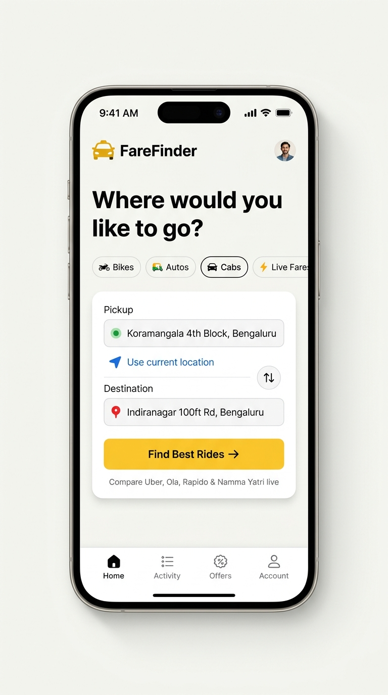
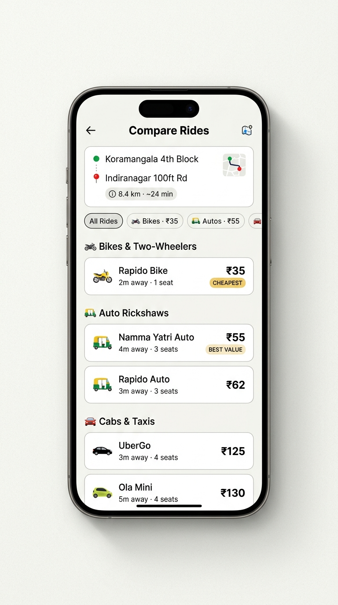

# FareFinder 🚗

A comprehensive Flutter mobile application for comparing cab fares across multiple ride-sharing services. FareFinder helps users make informed decisions by providing real-time fare estimates from various cab providers including Uber, Ola, Rapido, and BluSmart.

## App Screenshots 📱

| Home Screen | Fare Comparison (Bikes, Autos & Cabs) |
| :---: | :---: |
|  |  |


## Features ✨

### Frontend (Flutter)
- **Google Places Autocomplete**: Smart location search with real-time suggestions
- **Multi-Service Fare Comparison**: Compare fares across Uber, Ola, Rapido, and BluSmart
- **Clean, Intuitive UI**: Modern Material Design interface
- **State Management**: Efficient state management using Provider pattern
- **Responsive Design**: Optimized for various screen sizes
- **Booking Management**: Create and track booking history

### Backend (Node.js/Express)
- **RESTful API**: Clean API endpoints for fare estimation and booking management
- **Multi-Provider Integration**: Mock implementations for major cab services
- **CORS Support**: Cross-origin resource sharing enabled
- **Scalable Architecture**: Modular backend structure for easy expansion
- **Health Check Endpoint**: Monitor backend service status

## Tech Stack 🛠️

### Frontend
- **Flutter** (Dart)
- **Provider** - State management
- **HTTP** - API communication
- **Google Places API** - Location autocomplete
- **Material Design** - UI components

### Backend
- **Node.js** - Runtime environment
- **Express.js** - Web framework
- **CORS** - Cross-origin requests
- **Firebase Admin** (Ready for integration)

## Project Structure 📁

```
FareFinder/
├── lib/                          # Flutter source code
│   ├── models/                   # Data models
│   │   ├── booking.dart
│   │   ├── cab_service.dart
│   │   └── place_prediction.dart
│   ├── providers/                # State management
│   │   └── fare_provider.dart
│   ├── screens/                  # UI screens
│   │   ├── booking_history_screen.dart
│   │   ├── home_screen.dart
│   │   └── results_screen.dart
│   ├── services/                 # API and external services
│   │   ├── api_service.dart
│   │   └── places_service.dart
│   ├── widgets/                  # Reusable UI components
│   │   └── location_autocomplete.dart
│   └── main.dart                 # App entry point
├── backend/                      # Node.js backend
│   ├── server.js                 # Main server file
│   └── package.json              # Dependencies
└── README.md                     # Project documentation
```

## Getting Started 🚀

### Prerequisites
- Flutter SDK (latest version)
- Node.js and npm
- Google Cloud Platform account (for Places API)
- Android Studio or VS Code with Flutter extensions

### Backend Setup

1. **Navigate to backend directory**:
   ```bash
   cd backend
   ```

2. **Install dependencies**:
   ```bash
   npm install
   ```

3. **Start the server**:
   ```bash
   npm start
   ```
   The backend will run on `http://localhost:3000`

### Frontend Setup

1. **Install Flutter dependencies**:
   ```bash
   flutter pub get
   ```

2. **Configure Google Places API**:
   - Create a Google Cloud Platform project
   - Enable the Places API
   - Generate an API key
   - Update the API key in `lib/services/places_service.dart`:
     ```dart
     final String apiKey = 'YOUR_GOOGLE_PLACES_API_KEY';
     ```

3. **Run the app**:
   ```bash
   flutter run
   ```

## API Endpoints 🌐

### Backend API

- **GET** `/health` - Health check endpoint
- **POST** `/api/fare-estimate` - Get fare estimates
  ```json
  {"pickup": "Location Name", "destination": "Location Name"}
  ```
- **POST** `/api/bookings` - Create a new booking
- **GET** `/api/bookings/:userId` - Get user's booking history

### Google Places API Integration

The app integrates with Google Places API for:
- **Autocomplete**: Real-time location suggestions
- **Place Details**: Detailed information about selected locations
- **Geocoding**: Convert addresses to coordinates

## Key Features Implementation 🔧

### Google Places Autocomplete

The `LocationAutocomplete` widget provides:
- **Debounced Search**: Optimized API calls with 500ms delay
- **Real-time Suggestions**: Dynamic list of location predictions
- **Error Handling**: Graceful handling of API failures
- **Custom Styling**: Consistent with app theme

```dart
// Usage in HomeScreen
LocationAutocomplete(
  hintText: 'Enter pickup location',
  onPlaceSelected: (prediction) {
    // Handle place selection
  },
)
```

### Fare Comparison

The app compares fares across multiple services:
- **Uber**: Various ride types (UberGo, UberPremium, etc.)
- **Ola**: Multiple categories (Mini, Prime, etc.)
- **Rapido**: Bike and auto options
- **BluSmart**: Electric cab service

### State Management

Using Provider pattern for:
- **Fare Data**: Managing fare estimates and loading states
- **Location State**: Tracking pickup and destination selections
- **Booking History**: Managing user's booking records

## Configuration ⚙️

### Google Places API Setup

1. **Enable APIs**:
   - Places API
   - Geocoding API (optional, for coordinate conversion)

2. **API Key Restrictions** (Recommended):
   - Application restrictions: Android apps
   - API restrictions: Places API

3. **Billing**: Ensure billing is enabled for your GCP project

### Backend Configuration

The backend includes mock data for cab services. To integrate with real APIs:

1. **Add API keys** for each service in environment variables
2. **Implement actual API calls** in respective service modules
3. **Handle authentication** and rate limiting

## Development Guidelines 📝

### Flutter Best Practices
- Use proper state management with Provider
- Implement error handling for all API calls
- Follow Material Design guidelines
- Use const constructors where possible
- Implement proper loading states

### Backend Best Practices
- Use proper HTTP status codes
- Implement input validation
- Add proper error handling middleware
- Use environment variables for configuration
- Implement logging for debugging

## Troubleshooting 🔍

### Common Issues

1. **Google Places API not working**:
   - Check API key validity
   - Ensure Places API is enabled
   - Verify billing is set up
   - Check API quotas and limits

2. **Backend connection issues**:
   - Ensure backend is running on correct port
   - Check CORS configuration
   - Verify API endpoints are correct

3. **Flutter build issues**:
   - Run `flutter clean`
   - Delete `pubspec.lock` and run `flutter pub get`
   - Check Flutter and Dart SDK versions

### Debugging Tips

- Use Flutter Inspector for UI debugging
- Check browser developer tools for API calls
- Monitor backend logs for API errors
- Use `print()` statements for debugging state changes

## Future Enhancements 🚀

- **Firebase Integration**: User authentication and data persistence
- **Real-time Tracking**: Live tracking of booked rides
- **Payment Integration**: In-app payment processing
- **Push Notifications**: Ride status updates
- **Favorites**: Save frequently used locations
- **Price Alerts**: Notify users of fare changes
- **Route Optimization**: Suggest optimal routes
- **Multi-city Support**: Expand to multiple cities

## Contributing 🤝

1. Fork the repository
2. Create a feature branch (`git checkout -b feature/AmazingFeature`)
3. Commit your changes (`git commit -m 'Add some AmazingFeature'`)
4. Push to the branch (`git push origin feature/AmazingFeature`)
5. Open a Pull Request

## License 📄

This project is licensed under the MIT License - see the LICENSE file for details.

## Support 💬

If you have any questions or run into issues, please:
- Check the troubleshooting section above
- Open an issue on GitHub
- Review the Flutter and Node.js documentation

---

**Happy Coding! 🎉**
